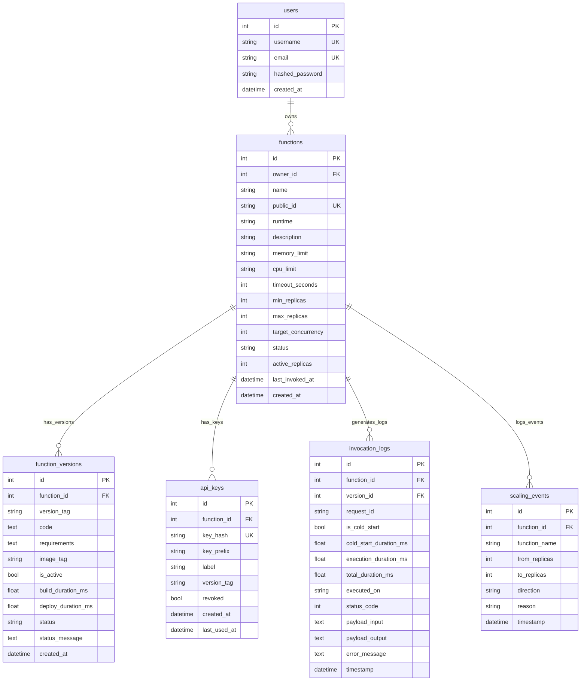
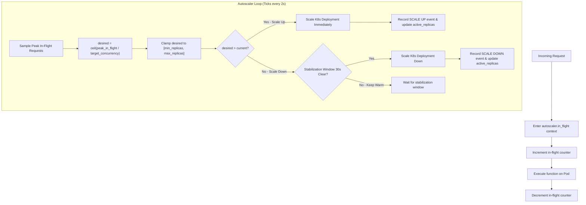

# MicroFaaS: System Architecture & Technical Working Guide
## Kubernetes-Based Docker Serverless (FaaS) Function Execution Platform

---

## 1. Executive Summary & Core Value Proposition

**MicroFaaS** is a self-hosted, enterprise-grade **Function-as-a-Service (FaaS)** execution engine modeled after AWS Lambda and Google Cloud Functions. It enables developers to author, version, orchestrate, and invoke event-driven functions over secure HTTP endpoints without managing servers, container configurations, or Kubernetes manifests.

### Key Architectural Pillars:
1. **Developer Simplicity**: Users write only business logic (e.g., `def handler(event): ...`) and specify resource boundaries (CPU, memory, timeout, concurrency target). The platform dynamically synthesizes Dockerfiles, builds container images, and manages Kubernetes deployments.
2. **Scale-to-Zero (True Serverless)**: Inactive functions consume **0 CPU and 0 MB RAM**. An automated background idle-reaper scales idle workloads down to 0 replicas, and resurrects them on-demand when traffic arrives.
3. **Cold vs. Warm Telemetry Separation**: Invocations measure container provisioning duration (cold start) separately from actual function execution time.
4. **Request-Driven Concurrency Autoscaling**: Functions dynamically scale up horizontally (e.g., $1 \to 2 \to 3$ pods) based on peak concurrent in-flight requests, with anti-flapping stabilization windows.
5. **Multi-Tenant Security & Pod Hardening**: Containers run under unprivileged non-root users (`uid 10001`), read-only root filesystems, dropped Linux capabilities, and strict hardware quotas.
6. **Platform-Wide & Per-Function Observability**: Prometheus instrumentation and deep telemetry APIs surface live p50/p95/p99 latency curves, invocation trends, autoscaling timelines, and full request/response JSON payload inspection drawers.

---

## 2. End-to-End System Architecture

```mermaid
flowchart TB
    subgraph ClientTier ["1. Client & Ingress Tier"]
        Dev["Developer / Web Dashboard<br/>(React + Vite :5173)"]
        ConsumerApp["External Consumer App<br/>(e.g., LeetCode Demo :5174)"]
        CurlClient["CLI / Webhooks / curl"]
    end

    subgraph ControlPlane ["2. MicroFaaS Control Plane (FastAPI :8000)"]
        APIGateway["FastAPI Gateway & Auth<br/>(JWT + SHA-256 API Keys)"]
        RouterService["Router Service<br/>(Cold-start locks, Proxy, Telemetry)"]
        BuilderService["Builder Service<br/>(Docker SDK context assembly)"]
        
        subgraph Daemons ["Background Daemons"]
            Autoscaler["Autoscaler Daemon<br/>(In-flight demand, 2s tick)"]
            IdleReaper["Idle Reaper Daemon<br/>(Scale-to-0, 10s tick)"]
            LogWorker["Async Batch Log Worker<br/>(Non-blocking SQLite writes)"]
        end
    end

    subgraph StorageTier ["3. Storage & Artifact Tier"]
        SQLiteDB[("SQLite Metadata DB<br/>faas_metadata.db (WAL Mode)")]
        DockerRegistry["Local Docker Registry<br/>localhost:5000 (registry:2)"]
    end

    subgraph K8sDataPlane ["4. Kubernetes Data Plane (faas-fn namespace)"]
        K8sAPI["Kubernetes API Server"]
        ClusterIP["ClusterIP Service<br/>fn-u1-fibonacci-calc-v1:8080"]
        
        subgraph PodReplicas ["Dynamic Pod Replicas (0 to N Pods)"]
            Pod1["Pod 1 (:8080)<br/>server.py + handler.py"]
            Pod2["Pod 2 (:8080)<br/>server.py + handler.py"]
            PodN["Pod N (:8080)<br/>server.py + handler.py"]
        end
    end

    Dev -->|Manage & Test| APIGateway
    ConsumerApp -->|POST /api/v1/f/{public_id}| APIGateway
    CurlClient -->|POST /api/v1/f/{public_id}| APIGateway

    APIGateway --> RouterService
    APIGateway --> BuilderService
    BuilderService --> DockerRegistry
    
    RouterService -->|Lookup & Fast Release| SQLiteDB
    RouterService -->|Cold-Start Provision & Proxy| K8sAPI
    RouterService -->|Enqueue telemetry| LogWorker
    LogWorker --> SQLiteDB

    Autoscaler -->|Query in-flight & Scale| K8sAPI
    Autoscaler -->|Sync replica counts| SQLiteDB
    IdleReaper -->|Reap idle >60s to 0| K8sAPI

    K8sAPI --> ClusterIP
    ClusterIP --> Pod1
    ClusterIP --> Pod2
    ClusterIP --> PodN
```

---

## 3. Database Architecture & Schema

The platform uses **SQLAlchemy 2.0 ORM** connected to **SQLite** (`faas_metadata.db`) configured with:
- **Write-Ahead Logging (WAL)** mode for concurrent readers and writers without lock contention.
- **Connection pooling**: `pool_size=20`, `max_overflow=40`, and `timeout=30s`.
- Automatic schema migration on startup (`_add_missing_columns` in `backend/app/core/db.py`).

### 3.1 Entity-Relationship (ER) Diagram



### 3.2 Schema Table Reference

#### 1. `users` Table
Stores registered platform developers.
- `id` (Integer, PK): User identifier.
- `username` (String(64), Unique, Indexed): Developer handle used in resource namespaces.
- `email` (String(128), Unique, Indexed): Login address.
- `hashed_password` (String(256)): Salted Bcrypt password hash.
- `created_at` (DateTime): Registration timestamp.

#### 2. `functions` Table
Stores the logical definition of functions.
- `id` (Integer, PK): Internal primary key.
- `owner_id` (Integer, FK &rarr; `users.id`): Enforces multi-tenant ownership.
- `name` (String(64), Indexed): Function name (DNS-1123 compliant: lowercase, hyphens allowed).
- `public_id` (String(64), Unique, Indexed): Stable, unguessable hex identifier (e.g. `c10011191155459b`) used for public routing (`/api/v1/f/{public_id}`).
- `runtime` (String(32)): Base runtime environment (e.g., `python311`).
- `description` (Text): Human-readable function description.
- `memory_limit` (String(16)): Kubernetes container memory cap (e.g., `256Mi`, `512Mi`).
- `cpu_limit` (String(16)): Kubernetes container CPU cap (e.g., `500m`, `1000m`).
- `timeout_seconds` (Integer): Maximum execution duration (default: 10s, max: 300s).
- `min_replicas` (Integer): Minimum replica floor. When set to `0`, Scale-to-Zero is active.
- `max_replicas` (Integer): Maximum replica cap for the autoscaler (default: 5, max: 20).
- `target_concurrency` (Integer): In-flight request target per Pod replica (default: 5).
- `status` (String(32)): State machine: `READY`, `RUNNING`, `SCALED_TO_ZERO`, `BUILDING`.
- `active_replicas` (Integer): Current number of active Pod replicas running in the cluster.
- `last_invoked_at` (DateTime, Indexed): Timestamp of the most recent invocation (used by the idle reaper).

#### 3. `function_versions` Table
Maintains an immutable historical record of every deployment for every function.
- `id` (Integer, PK): Version ID.
- `function_id` (Integer, FK &rarr; `functions.id`): Parent function reference.
- `version_tag` (String(32)): Monotonically increasing version tag (`v1`, `v2`, ...).
- `code` (Text): The raw Python source code deployed for this version.
- `requirements` (Text): The `requirements.txt` dependencies.
- `image_tag` (String(256)): The compiled Docker image tag (`localhost:5000/<owner>/<name>:<ver>`).
- `is_active` (Boolean): True once the Docker build and Kubernetes deployment succeed.
- `build_duration_ms` (Float): Time taken by Docker daemon to assemble and push the image.
- `deploy_duration_ms` (Float): Time taken by Kubernetes to schedule and report Pod readiness.
- `status` (String(32)): `READY`, `BUILDING`, or `FAILED`.
- `status_message` (Text): Build or deployment failure stack traces if applicable.

#### 4. `api_keys` Table
Scoped authentication credentials enabling external systems to invoke functions.
- `id` (Integer, PK): Key ID.
- `function_id` (Integer, FK &rarr; `functions.id`): Scoped to exactly one function.
- `key_hash` (String(64), Unique, Indexed): SHA-256 hash of the API key token.
- `key_prefix` (String(16)): First 8 characters (e.g., `fk_L9Lv7e...`) for UI identification.
- `label` (String(64)): Friendly name (e.g., `leetcode-prod-key`).
- `version_tag` (String(32), Nullable): When populated, pins this key strictly to a single version (e.g., `v1`).
- `revoked` (Boolean): Revocation status.
- `last_used_at` (DateTime): Timestamp of the most recent invocation authenticated by this key.

#### 5. `invocation_logs` Table
Granular historical execution telemetry.
- `id` (Integer, PK): Log ID.
- `function_id` (Integer, FK &rarr; `functions.id`): Target function.
- `version_id` (Integer, FK &rarr; `function_versions.id`): Executed version.
- `request_id` (String(64), Indexed): Unique UUID generated per request.
- `is_cold_start` (Boolean): True if container provisioning occurred during this call.
- `cold_start_duration_ms` (Float): Duration of container scale-up and readiness polling.
- `execution_duration_ms` (Float): Execution duration inside the function container.
- `total_duration_ms` (Float): Total end-to-end latency (`cold_start + execution`).
- `executed_on` (String(16)): Execution engine (`k8s`, `sandbox`, or `none`).
- `status_code` (Integer): HTTP status (200, 400, 404, 500, 502, 504).
- `payload_input` (Text): Incoming JSON request body.
- `payload_output` (Text): Returned JSON response body.
- `error_message` (Text): Runtime error or exception trace if execution failed.
- `timestamp` (DateTime, Indexed): Execution start timestamp in UTC (serialized with `"Z"`).

#### 6. `scaling_events` Table
Persistent audit log of horizontal autoscaling operations.
- `id` (Integer, PK): Scaling event ID.
- `function_id` (Integer, FK &rarr; `functions.id`): Function reference.
- `function_name` (String(64)): Name of the function.
- `from_replicas` (Integer): Replica count before scaling.
- `to_replicas` (Integer): Replica count after scaling.
- `direction` (String(16)): `UP` or `DOWN`.
- `reason` (String(256)): Explanation (e.g., `Autoscaler peak in-flight=12, target=5`).
- `timestamp` (DateTime, Indexed): Timestamp of the scaling event in UTC.

---

## 4. Storage Model: Where Everything Lives

| Artifact | Physical Storage Location | Lifecycle & Retention |
| :--- | :--- | :--- |
| **Source Code** | Database column `function_versions.code` in `faas_metadata.db` | Immutable and persistent across container restarts. |
| **Dependencies** | Database column `function_versions.requirements` in `faas_metadata.db` | Immutable per version. |
| **Container Images** | Docker Engine Store & Local Registry (`localhost:5000/<owner>/<name>:<ver>`) | Cached locally; tagged immutably per version. |
| **Build Context** | Host temporary directory (`tempfile.TemporaryDirectory()`) | Discarded immediately after image compilation finishes. |
| **Active Pod Filesystem** | Container rootfs inside Kubernetes Pod | **Read-only root**; user code lives at `/app/handler.py`. |
| **Subprocess Workspaces** | Pod in-memory RAM disk (`emptyDir` mounted at `/tmp`) | Ephemeral; wiped upon Pod shutdown or execution cleanup. |
| **Telemetry & Metrics** | SQLite `invocation_logs` + In-memory Prometheus gauges | Logs stored persistently; metrics aggregated in real-time. |

---

## 5. End-to-End Function Lifecycle: Step-by-Step

### Phase 1: Function Creation & Image Synthesis
1. **User Action**: The user submits code, runtime (`python311`), resource limits (`256Mi`, `500m`), and autoscaling bounds (`min: 0`, `max: 5`, `target: 5`).
2. **API Ingestion**: `POST /api/v1/functions/` creates the function record and increments version tag to `v1`.
3. **Builder Synthesis** (`backend/app/services/builder.py`):
   - A scratch folder is created.
   - User code is written to `handler.py`.
   - Dependencies are written to `requirements.txt`.
   - Base runtime server `server.py` and `Dockerfile.template` are copied from `backend/runtimes/python311/`.
   - Docker daemon builds the image with non-root user setup (`uid 10001`).
   - Image is tagged `localhost:5000/u1/fibonacci-calc:v1` and pushed to the local registry.
4. **Kubernetes Deployment Manifest** (`backend/app/services/k8s_client.py`):
   - MicroFaaS applies a Kubernetes Deployment (`fn-u1-fibonacci-calc-v1`) and ClusterIP Service (`fn-u1-fibonacci-calc-v1:8080`) in the `faas-fn` namespace.
   - Resource requests/limits and `/healthz` readiness probes are configured.
   - If `min_replicas=0`, replicas is set to `0` immediately.

### Phase 2: Credential & Endpoint Generation
1. The developer opens the **API Access Panel** and clicks *Create Key*.
2. A random cryptographic key is generated: `fk_L9Lv7eXosU6sg33Byg373M5iJfLHgAd301EBWPcOaiI`.
3. The platform computes its SHA-256 hash, stores the hash in `api_keys`, and presents the token to the user once.
4. An external application configures:
   ```env
   FAAS_BASE_URL=http://localhost:8000
   FAAS_PUBLIC_ID=c10011191155459b
   FAAS_API_KEY=fk_L9Lv7eXosU6sg33Byg373M5iJfLHgAd301EBWPcOaiI
   ```

### Phase 3: The First Call — Cold Start Lifecycle ($0 \to 1$ Pod)
1. **Ingress**: External caller sends:
   ```http
   POST /api/v1/f/c10011191155459b
   X-API-Key: fk_L9Lv...
   Content-Type: application/json

   {"n": 35}
   ```
2. **Fast Connection Release**: Router resolves version `v1` and **immediately closes the database connection**. This prevents connection pool exhaustion during long provisioning waits or bursts.
3. **Cold Start Stampede Lock**: Router checks `_warm_versions`. Since the Deployment is scaled to 0, it enters an `asyncio.Lock` for this resource. All concurrent requests wait on this single lock so only **one** scale-up is triggered.
4. **Pod Scheduling & Polling**:
   - `k8s_service.scale_deployment(resource, 1)` scales the deployment to 1 replica.
   - Kubernetes schedules the Pod, pulls the image, and launches `server.py`.
   - Router polls `GET /healthz` until the Pod responds 200 OK.
   - Cold start timer records duration (e.g. $2140\text{ ms}$).
5. **Execution Proxying**:
   - Router dispatches HTTP POST to `http://fn-u1-fibonacci-calc-v1.faas-fn:8080/execute` with `{"n": 35}`.
   - In-container `server.py` invokes `handler({"n": 35})`.
   - Execution finishes in $45\text{ ms}$.
6. **Asynchronous Batch Logging**:
   - Invocation telemetry is pushed into `_log_queue`.
   - An asynchronous background worker (`_batch_log_worker`) writes records to SQLite in batches, keeping the request path non-blocking.
7. **Client Response**:
   ```json
   {
     "request_id": "8a3d4f12-...",
     "status_code": 200,
     "is_cold_start": true,
     "cold_start_duration_ms": 2140.2,
     "execution_duration_ms": 45.1,
     "total_duration_ms": 2185.3,
     "result": {"result": 9227465}
   }
   ```

### Phase 4: Subsequent Calls — Warm Start Dispatch (< 50 ms)
- The resource is already present in `_warm_versions`.
- Cold start is bypassed entirely (`cold_start_duration_ms: 0.0`, `is_cold_start: false`).
- Request is proxied directly to the ready Pod, returning in **~40–55 ms total latency**.

---

## 6. Traffic Scaling, Concurrency & Scale-to-Zero

The platform implements a **Request-Driven Horizontal Autoscaler** (`backend/app/services/autoscaler.py`) executing inside a controller loop every 2 seconds.



### 1. In-Flight Concurrency Tracking
Every request passing through `RouterService` executes inside:
```python
with autoscaler.in_flight(resource):
    # Call Pod HTTP endpoint
```
This tracks concurrent active connections across all Pod replicas without relying on asynchronous scrape latency.

### 2. Autoscaler Decision Math
Every 2 seconds, `autoscaler.tick()` computes the required Pod count:
$$\text{desired\_replicas} = \max\left(\text{min\_replicas}, \min\left(\text{max\_replicas}, \left\lceil \frac{\text{peak in-flight requests}}{\text{target\_concurrency}} \right\rceil\right)\right)$$

- **Scale Up (Immediate)**: When concurrent traffic surges (e.g. from 1 to 15 concurrent requests with target 5), $\lceil 15 / 5 \rceil = 3$ Pods. The autoscaler calls Kubernetes immediately: `1 -> 2 -> 3 Pods`.
- **Scale Down (Damped Anti-Flapping)**: To prevent Pods from thrashing during brief traffic dips, scale down is governed by `SCALE_DOWN_STABILIZATION_SECONDS = 30s`. The autoscaler will only scale down to the highest demand observed across the last 30 seconds.
- **Live Memory Replica Resolution**: `autoscaler.get_current_replicas(fn_id)` exposes the live replica count directly to the `/api/v1/stats` dashboard endpoint so top-level cards update immediately without waiting for database writes.

### 3. Idle Reaper (Scale-to-Zero)
A dedicated daemon (`backend/app/services/controller.py`) runs every 10 seconds:
- If `min_replicas == 0` and $\text{now} - \text{last\_invoked\_at} > 60\text{ seconds}$:
- MicroFaaS scales the Kubernetes Deployment from $1 \to 0$ replicas.
- The Pod is terminated, releasing 100% of its CPU and memory back to the cluster.
- Function status transitions to `SCALED_TO_ZERO`.

---

## 7. Container Anatomy & Pod Security Model

All user functions execute inside hardened Linux containers scheduled in the isolated `faas-fn` Kubernetes namespace:

```
                      KUBERNETES POD (:8080)
┌─────────────────────────────────────────────────────────────────────────┐
│  Security Context:                                                      │
│  - Non-root user: uid 10001 (faasuser)                                  │
│  - readOnlyRootFilesystem: true                                         │
│  - Linux capabilities: drop: ["ALL"]                                    │
│  - Resource Limits: CPU 500m (0.5 core), Memory 256Mi                   │
│                                                                         │
│  ┌───────────────────────────────────────────────────────────────────┐  │
│  │ HTTP Runtime Server (server.py on port 8080)                      │  │
│  │  - GET /healthz  -> Readiness Probe (200 OK)                      │  │
│  │  - POST /execute -> Loads handler.py with execution timeout        │  │
│  └─────────────────────────────────┬─────────────────────────────────┘  │
│                                    │ invokes                            │
│  ┌─────────────────────────────────▼─────────────────────────────────┐  │
│  │ User Function (handler.py)                                        │  │
│  │  def handler(event):                                              │  │
│  │      return {"result": compute(event)}                            │  │
│  └───────────────────────────────────────────────────────────────────┘  │
└─────────────────────────────────────────────────────────────────────────┘
```

### In-Container Runtime Server (`server.py`)
- Standardized, lightweight multithreaded HTTP server listening on port `8080`.
- **Endpoints**:
  - `GET /healthz`: Kubernetes readiness and liveness probe (returns HTTP 200 once `handler.py` is dynamically imported and verified).
  - `POST /execute`: Accepts JSON input payload, extracts arguments, and invokes `handler(event)`.
- **Timeout Protection**: Runs handlers in an isolated worker pool. If execution exceeds `EXECUTION_TIMEOUT`, it responds immediately with HTTP 504 (*Timed Out*), preventing lingering requests from jamming the server.

### Subprocess Sandbox Isolation (for LeetCode / Code-as-a-Service)
For running untrusted student Python code (`backend/runtimes/python311/code_executor_handler.py`):
- Code is **never** executed using `exec()` in the main server process.
- Each submission creates an ephemeral folder in `/tmp/exec_<uuid>/` (the only writable in-memory `emptyDir` mount).
- A fresh OS subprocess `python3 -u main.py` is spawned.
- Environment variables containing platform secrets (`SECRET_KEY`, `DATABASE_URL`, `POSTGRES_PASSWORD`) are filtered out.
- Standard input (`stdin`), standard output (`stdout`), and standard error (`stderr`) are captured with a 1 MB size limit to eliminate memory exhaustion vulnerabilities.

---

## 8. Platform Management & Control Hierarchy

| Component | Layer | Primary Responsibility |
| :--- | :--- | :--- |
| **FastAPI Gateway & Router** | Control Plane | Request ingress, API key verification, version routing, cold start concurrency locks, DB connection recycling, Prometheus metric instrumentation. |
| **Builder Service** | Build Pipeline | Dockerfile synthesis, multi-layer build, tagging, local registry push. |
| **Autoscaler Daemon** | Controller Loop | Evaluates in-flight demand every 2s, triggers horizontal Pod scale-out ($1 \to 3$), enforces 30s damping window on scale-down. |
| **Idle Reaper Daemon** | Controller Loop | Scans functions every 10s, scales dormant workloads ($>60\text{s}$ idle) down to 0 replicas. |
| **Kubernetes Control Plane** | Infrastructure | Pod scheduling, container lifecycle, readiness probing, OOM killing, and internal ClusterIP network load balancing. |

---

## 9. Observability & Telemetry Subsystem

The platform provides a comprehensive **Observability Suite** accessible via `/api/v1/observability/*` and the React Web Dashboard:

1. **Platform Summary KPIs**: Aggregated requests per second (RPS), success/error rates, concurrent in-flight requests, and cold vs. warm start ratios across configurable time windows (`15m`, `1h`, `6h`, `24h`, `all`).
2. **Active Pods Tracking**: Real-time resolution of active container replicas reflecting autoscaling events as they occur.
3. **Latency Percentile Graphs**: Real-time charts plotting p50 (median), p95, and p99 execution duration curves.
4. **Autoscaling Timeline**: Detailed event logs with timestamps, direction (`SCALE UP` / `SCALE DOWN`), replica delta ($1 \to 3$), and triggering reason.
5. **Cluster Pod Health**: Live inspection of ready pods, container restarts, OOM kills, and CPU/memory utilization percentages.
6. **Telemetry History & Payload Drawer**: Interactive table of individual invocation records. Clicking any row expands a code viewer displaying the exact **Incoming Request JSON** and **Returned Output JSON** with one-click clipboard copying.
7. **Timezone Normalization**: All backend timestamps are strictly serialized as UTC ISO strings with trailing `"Z"` and rendered automatically in the developer's local browser timezone.

---

## 10. Operational Verification & Testing Tools

The repository includes dedicated test and demonstration tools to verify every component of the system:

- **Autoscaler Live Burst Demonstration**:
  - `run-autoscale-demo.bat` & `demo_autoscale_fibonacci.py`: Fires synchronized concurrent bursts (using `threading.Barrier`) to demonstrate horizontal autoscaling from 1 to 3+ pods live in the Observability dashboard.
- **Automated Pytest Suite**:
  - `backend/tests/test_observability.py`: Verifies percentile computations, time-series bucketing, concurrency gauges, and offline Kubernetes fallback handling.
  - `backend/tests/test_code_executor.py`: Validates isolated subprocess execution, memory caps, timeout kills, and syntax/runtime error trapping.
- **Standalone LeetCode Demo**:
  - `start-leetcode.bat` & `Leet-Code-Demo/`: Launches a complete coding challenge platform powered by MicroFaaS functions over scoped API keys.
- **One-Click Stack Launcher**:
  - `start-all.bat` & `start-all.ps1`: Automated PowerShell orchestrator that starts the Docker registry, initializes the FastAPI backend on port 8000, boots the React UI on port 5173, and binds public Ngrok tunnels.
